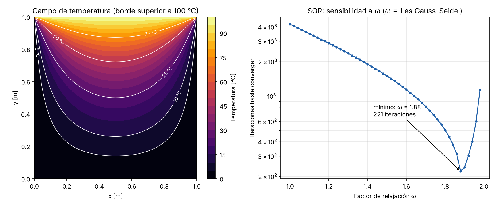

# Conducción de calor 2D — Jacobi, Gauss-Seidel y SOR (C++)

Solver en **C++17** de la ecuación de Laplace en una placa rectangular (conducción de calor en estado estacionario), con tres métodos iterativos y validación contra la **solución analítica por series de Fourier**.

Es el mismo tipo de problema que aparece en mi investigación sobre pavimentos rígidos ([pavimento-fourier-heladas-cusco](https://github.com/261893-web/pavimento-fourier-heladas-cusco)), pero resuelto numéricamente: la serie de Fourier sirve como referencia exacta y el código en C++ permite ver cuánto cambia el costo computacional según el método.



## Problema

```
∂²T/∂x² + ∂²T/∂y² = 0        en la placa
T = f(x) o g(y)              en cada borde (Dirichlet)
```

Discretización con diferencias finitas de 5 puntos (malla uniforme de paso `h`):

```
T[i,j] = ¼ · (T[i+1,j] + T[i−1,j] + T[i,j+1] + T[i,j−1])
```

| Método | Actualización |
|---|---|
| Jacobi | Usa solo valores de la iteración anterior |
| Gauss-Seidel | Usa los valores nuevos apenas se calculan |
| SOR | Gauss-Seidel sobre-relajado: `T ← T + ω·(T_GS − T)` con ω óptimo teórico `2 / (1 + √(1 − ρ²))` |

## Resultados (malla 51 × 51, tolerancia 10⁻⁸)

```
Método         Iteraciones  Tiempo [ms] Error en (0.5, 0.25)
Jacobi                 8048         53.9           0.0069
Gauss-Seidel           4212         83.7           0.0069
SOR                     208          3.9           0.0070

ω óptimo teórico: 1.8818 | mejor ω del barrido: 1.88 (221 iteraciones)
```

Lo que muestran:

- **SOR converge unas 40 veces más rápido** que Jacobi y unas 20 veces más rápido que Gauss-Seidel. El barrido de ω confirma que el valor teórico es el óptimo y que pasarse de él (ω → 2) empeora rápido.
- **Gauss-Seidel hace la mitad de iteraciones que Jacobi pero tarda más.** Cada nodo depende del valor recién calculado en el nodo anterior, y esa dependencia impide que el compilador vectorice el bucle (Jacobi sí se vectoriza). Menos iteraciones no siempre significan menos tiempo.
- Los tres métodos llegan a la misma solución: el error frente a Fourier (≈ 0.007 °C) es de **discretización**, no de convergencia, y solo baja refinando la malla.

## Validación

Pruebas en `tests/test_laplace2d.cpp`, sin dependencias externas:

| Prueba | Qué verifica |
|---|---|
| Serie de Fourier en el centro | Da 25 °C, como exige la superposición de los 4 bordes |
| Métodos vs Fourier | Los tres coinciden con la solución exacta (error < 0.05 °C, malla 41 × 41) |
| Campo lineal | `T = 3 + 2x − y` se reproduce con error < 10⁻⁹ (el esquema es exacto para funciones lineales) |
| Orden de convergencia | Con borde senoidal, al dividir `h` entre 2 el error cae 4 veces: **orden 2** |
| Eficiencia | SOR necesita al menos 5 veces menos iteraciones que Gauss-Seidel |
| Entradas inválidas | ω fuera de (0, 2) y pasos distintos en x e y lanzan excepción |

## Compilar y ejecutar

```bash
cmake -S . -B build -DCMAKE_BUILD_TYPE=Release
cmake --build build
ctest --test-dir build --output-on-failure
./build/conduccion2d resultados          # genera los CSV
python scripts/graficar.py resultados figuras
```

Funciona con GCC, Clang y MSVC (en Windows el ejecutable queda en `build/Release/`).

## Estructura

```
include/laplace2d.hpp   interfaz: Placa, Malla, Metodo, solucion_fourier
src/laplace2d.cpp       métodos iterativos, interpolación bilineal, exportación CSV
src/main.cpp            comparación de métodos y barrido de ω
tests/                  pruebas
scripts/graficar.py     figuras a partir de los CSV
```

## Posibles extensiones

- Bordes con convección (Robin) para modelar la superficie de un pavimento expuesta al aire.
- Término fuente (ecuación de Poisson), por ejemplo calor de hidratación del concreto.
- Multigrid o gradiente conjugado, y paralelizar SOR con ordenamiento rojo-negro y OpenMP.

## Referencias

- Incropera, F. et al. *Fundamentals of Heat and Mass Transfer*, cap. 4.
- Burden, R. y Faires, J. *Análisis Numérico*, cap. 7 y 12.
